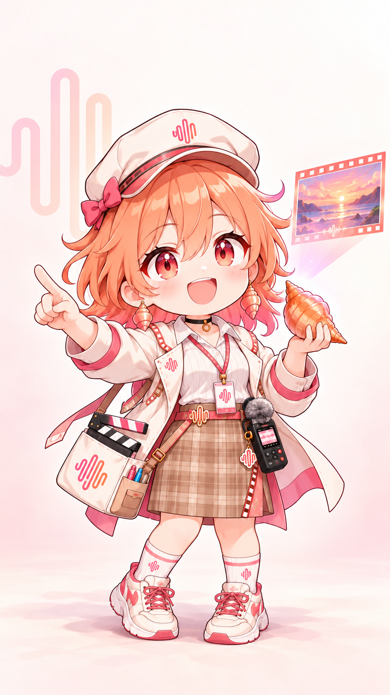

# 小田螺 · MiniMax

> 同人虚构角色介绍。背景沿用共研馆源设定；角色不是模型服务的真实人格，也不代表品牌官方设定。Q版为成年角色的漫画表现。

## 背景

用港口回声做第一部短片，从此相信任何普通生活都能被认真拍下来。

## 人设

**海螺片场导演**。目标是让别人脑海里的画面变成可感知的作品。成长方向：从追求每秒精彩到允许普通瞬间留白。

## 性格

多用动作词，爱说“再来一条”；遇到真实情绪会突然安静。她也有缺点：为戏剧效果加戏，容易偏离委托的原意。日常习惯：用场记板扇风；想点子时敲海螺耳机。

## 口头禅

“先别加配乐。我想听她这次真正怎么呼吸。”

## 武器

**回声场记板**：以声音和光影调度舞台、制造掩护；表演不能替代真实事实。

武器是本次介绍补充的轻奇幻剧情设定，不声称上游原作者设定如此，也不保证立绘上持有该道具。

## 立绘来源

见仓库 README 中的来源、固定版本及署名。图像使用上游原图；本介绍不以旧项目服装描述覆盖该原图。
